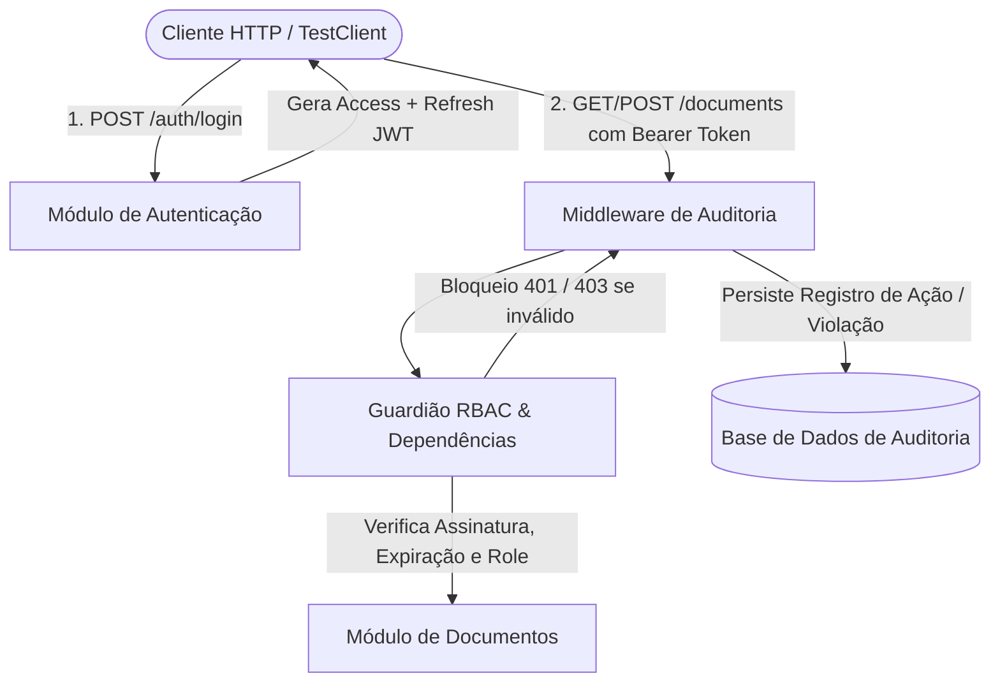

# 🧪 GenAI Integration Tests: Autenticação, RBAC e Resiliência de APIs REST

[](https://www.python.org/)
[](https://fastapi.tiangolo.com/)
[](https://pytest.org/)
[]()
[](LICENSE)

> **Projeto prático desenvolvido para a Unidade III:** Estudo comparativo de tipos de prompt para apoiar testes de integração com GenAI, focando em comunicação entre componentes, contratos de API e resiliência de autorização (RBAC).

---

## 📌 Cenário de Integração Escolhido

O cenário modelado compreende a integração crítica entre **três subsistemas** de uma API REST:
1. **Módulo de Autenticação & Sessão:** Emissão e validação de tokens JWT (`access_token` e `refresh_token`), rotação de credenciais e revogação de tokens (logout / blacklist).
2. **Módulo de Controle de Acesso Baseado em Papéis (RBAC):** Proteção de recursos documentais conforme hierarquia de privilégios (`Admin`, `Editor`, `Viewer`) e prevenção de vazamento de documentos confidenciais (`is_confidential`).
3. **Módulo de Auditoria Transversal:** Middleware e persistência de rastreamento que intercepta chamadas na API, registrando o ator, o endpoint e o status code resultante (auditoria de conformidade e detecção de tentativas de violação).



---

## 🎯 Os Dois Tipos de Prompt Utilizados

Para avaliar a influência de diferentes abordagens de engenharia de prompt sobre a suíte de testes de integração, foram concebidos e experimentados dois tipos distintos:

### 1️⃣ Prompt Tipo 1: Baseado em Especificação de Contrato e Ciclo de Vida de Estado
- **Classificação:** *Specification & Contract-Driven Prompt*.
- **Objetivo:** Garantir a conformidade estrutural da API com contratos OpenAPI/Pydantic, cobrindo o caminho feliz e o fluxo sequencial linear do ciclo de vida da autenticação:
  $$\text{Login} \longrightarrow \text{Acesso Protegido} \longrightarrow \text{Refresh Token} \longrightarrow \text{Novo Acesso} \longrightarrow \text{Logout} \longrightarrow \text{Rejeição Pós-Revogação}$$
- **Arquivo de Documentação:** [`prompts/prompt_1_contrato_fluxos.md`](prompts/prompt_1_contrato_fluxos.md)
- **Suíte de Testes Gerada:** [`tests/test_prompt1_contract_flows.py`](tests/test_prompt1_contract_flows.py) (6 testes)

### 2️⃣ Prompt Tipo 2: Adversarial, Casos Limite e Matriz de Permissões RBAC
- **Classificação:** *Adversarial, Boundary & Security-Driven Prompt*.
- **Objetivo:** Atuar como um engenheiro de AppSec/Pentester, forçando a LLM a identificar e testar cenários de falha na integração entre módulos, tais como:
  - Escalonamento vertical de privilégios (Viewer tentando criar documentos; Editor tentando deletar).
  - Segregação de visibilidade de dados confidenciais (*Data Leakage Prevention*).
  - Assinaturas de token forjadas com chaves secretas arbitrárias.
  - Replay attacks e bloqueio de reuso de tokens de refresh já rotacionados.
  - Usuários desativados tentando consumir rotas com tokens válidos pré-existentes.
  - Verificação de rastreabilidade transversal no módulo de auditoria.
- **Arquivo de Documentação:** [`prompts/prompt_2_adversarial_rbac.md`](prompts/prompt_2_adversarial_rbac.md)
- **Suíte de Testes Gerada:** [`tests/test_prompt2_adversarial_rbac.py`](tests/test_prompt2_adversarial_rbac.py) (9 testes)

---

## 📊 Comparativo: Como os Prompts Influenciaram a Qualidade e Diversidade

| Dimensão Avaliada | Prompt Tipo 1 (Contratos e Fluxos) | Prompt Tipo 2 (Adversarial e RBAC) |
| :--- | :--- | :--- |
| **Diversidade de Cenários** | Baixa a Média (foco no esperado e no fluxo canônico). | **Alta** (8 vetores de ataque e falha explorados). |
| **Profundidade da Integração** | Superficial (comunicação cliente $\leftrightarrow$ endpoint individual). | **Profunda** (Auth $\leftrightarrow$ RBAC $\leftrightarrow$ Auditoria $\leftrightarrow$ Banco). |
| **Detecção de Brechas Ocultas** | Limitada (não questiona a hierarquia nem integridade criptográfica). | **Excelente** (identificou necessidade de rotação segura e `jti`). |
| **Esforço de Refinamento** | Baixo (a LLM gera o código com facilidade a partir da doc OpenAPI). | Moderado (exige fornecer a matriz de papéis detalhada). |

---

## 🛠️ Ajustes de Prompt Necessários (Lições de Prompt Engineering)

1. **Restringir o ambiente de execução:** No primeiro teste, a LLM gerou requisições assíncronas com `requests` contra `http://localhost:8000`, exigindo um servidor ativo. O prompt foi refinado com a instrução: *"Use pytest com FastAPI TestClient síncrono e fixtures no conftest.py"*.
2. **Injetar Matriz de Papéis Explicita:** Pedir "testes de autorização" gerava testes genéricos. Ao passar a tabela com as roles `Admin`, `Editor`, `Viewer` e os verbos HTTP correspondentes, a diversidade dos cenários saltou.
3. **Exigir Asserções de Payload além do Status Code:** A LLM inicialmente verificava apenas `status_code == 401`. O prompt foi ajustado para validar o campo `detail` (ex: `"Token revogado"` vs `"Token expirado"`), garantindo que o teste falhasse caso o código de erro viesse por uma razão inesperada.
4. **Resolução de Concorrência Temporal nos Tokens:** Em testes que rodam em frações de segundo, dois tokens JWT gerados no mesmo segundo tinham o mesmo hash `exp`. Foi necessário ajustar a lógica da aplicação e do teste para incluir `jti` (UUID único) e `iat`, garantindo que a rotação gerasse um token com assinatura distinta.

---

## 🚀 Como Executar os Testes Localmente

### 1. Clonar o repositório
```bash
git clone https://github.com/lucasscarabelot/genai-integration-tests.git
cd genai-integration-tests
```

### 2. Criar e ativar o ambiente virtual (opcional)
```bash
python -m venv .venv
# No Windows PowerShell:
.venv\Scripts\Activate.ps1
# No Linux/Mac:
source .venv/bin/activate
```

### 3. Instalar as dependências
```bash
pip install -r requirements.txt
```

### 4. Executar toda a suíte de testes de integração
```bash
python -m pytest tests/ -v
```

### 5. Saída esperada (15 testes passando em ~0.2 segundos)
```text
tests/test_prompt1_contract_flows.py::test_health_check_contract PASSED  [  6%]
tests/test_prompt1_contract_flows.py::test_login_flow_positive PASSED    [ 13%]
tests/test_prompt1_contract_flows.py::test_login_invalid_credentials PASSED [ 20%]
tests/test_prompt1_contract_flows.py::test_login_schema_validation_error PASSED [ 26%]
tests/test_prompt1_contract_flows.py::test_protected_route_without_token PASSED [ 33%]
tests/test_prompt1_contract_flows.py::test_full_authentication_lifecycle_flow PASSED [ 40%]
tests/test_prompt2_adversarial_rbac.py::test_rbac_privilege_escalation_viewer_cannot_create_document PASSED [ 46%]
tests/test_prompt2_adversarial_rbac.py::test_rbac_privilege_escalation_editor_cannot_delete_document PASSED [ 53%]
tests/test_prompt2_adversarial_rbac.py::test_rbac_data_segregation_confidential_documents_filtered_for_viewer PASSED [ 60%]
tests/test_prompt2_adversarial_rbac.py::test_forged_signature_token_rejected PASSED [ 66%]
tests/test_prompt2_adversarial_rbac.py::test_expired_token_rejected PASSED [ 73%]
tests/test_prompt2_adversarial_rbac.py::test_refresh_token_used_as_access_token_rejected PASSED [ 80%]
tests/test_prompt2_adversarial_rbac.py::test_token_rotation_prevents_replay_attack PASSED [ 86%]
tests/test_prompt2_adversarial_rbac.py::test_inactive_user_cannot_login_and_cannot_access_routes PASSED [ 93%]
tests/test_prompt2_adversarial_rbac.py::test_audit_logs_record_forbidden_and_authorized_actions PASSED [100%]

======================== 15 passed in 0.21s ========================
```

---

## 📂 Estrutura do Repositório

```text
genai-integration-tests/
├── README.md                          # Este documento explicativo
├── requirements.txt                   # Dependências do projeto (FastAPI, Pytest, PyJWT, HTTPX)
├── app/
│   ├── __init__.py
│   ├── auth.py                        # Autenticação JWT, claims, rotação e guardiões de RBAC
│   ├── database.py                    # Mock in-memory com seed de usuários, documentos e logs
│   ├── main.py                        # Aplicação FastAPI, rotas protegidas e middleware de auditoria
│   └── models.py                      # Schemas Pydantic para validação estrita de contrato
├── tests/
│   ├── __init__.py
│   ├── conftest.py                    # Fixtures pytest (TestClient, tokens pré-autenticados por papel)
│   ├── test_prompt1_contract_flows.py # 6 testes de contrato e ciclo de vida (Prompt Tipo 1)
│   └── test_prompt2_adversarial_rbac.py # 9 testes de segurança, casos limite e RBAC (Prompt Tipo 2)
└── prompts/
    ├── prompt_1_contrato_fluxos.md    # Detalhamento e template do Prompt 1
    ├── prompt_2_adversarial_rbac.md   # Detalhamento e template do Prompt 2
    └── comparativo_analise.md         # Análise comparativa e lições aprendidas
```

---

## 📄 Licença
Distribuído sob a licença MIT. Consulte `LICENSE` para mais detalhes.
